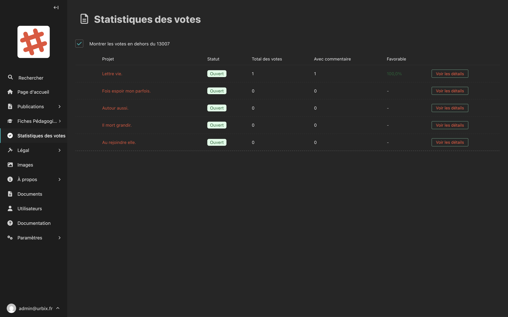
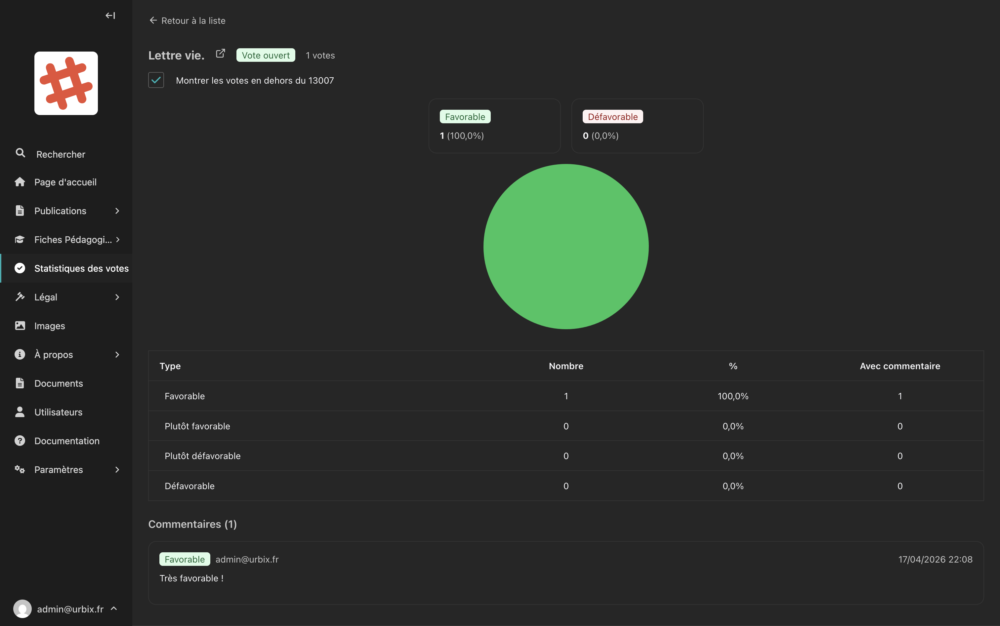

# Statistiques des avis

La section **Statistiques des avis** vous permet de consulter en temps réel les résultats des avis citoyens sur les projets.

## Accéder aux statistiques

Dans la barre latérale, ouvrez **Participation** puis cliquez sur **Avis**. Les avis en cours apparaissent aussi sur le tableau de bord, dans « Consultations à suivre ».

## La vue d'ensemble

<!-- Capture d'écran : tableau listant les projets avec leurs statistiques d'avis -->

Le tableau affiche pour chaque projet :

| Colonne | Description |
|---|---|
| **Projet** | Le nom du projet, cliquable pour voir le détail |
| **Statut** | **Ouvert** (recueil d'avis en cours) ou **Fermé** (recueil d'avis clôturé) |
| **Total des avis** | Le nombre total d'avis enregistrés |
| **Avec commentaire** | Le nombre d'avis accompagnés d'un commentaire |
| **Favorable** | La proportion d'avis favorables |

### Filtre géographique

Par défaut, seuls les avis des habitants du **code postal 13007** sont affichés.

Cochez la case **"Montrer les avis en dehors du 13007"** pour inclure tous les avis, quelle que soit l'origine géographique.

## Voir le détail d'un projet

Cliquez sur **"Voir les détails"** (ou sur le nom du projet) pour accéder à la page de détail.

<!-- Capture d'écran : page de détail des avis d'un projet avec le statut et la liste des avis -->

La page de détail affiche :
- Le **statut** des avis (Ouvert / Fermé)
- Le **nombre total d'avis**
- La liste individuelle des avis (si des avis ont été enregistrés)

> **Remarque :** Le recueil d'avis se clôture automatiquement à la **date de fin** définie dans le formulaire du projet. Vous ne pouvez pas modifier les avis des habitants.

## Clore les avis plus tôt

Dans le formulaire du projet, ouvrez le menu **···** en haut, puis **Clore les avis et envoyer les résultats**, et confirmez. Le recueil d'avis s'arrête immédiatement, les résultats s'affichent sur la page du projet et les participants qui l'ont demandé les reçoivent par email. Cette action est définitive.

## Comprendre le statut "Avis ouverts" / "Avis fermés"

| Statut | Signification |
|---|---|
| **Avis ouverts** | Les citoyens peuvent encore donner leur avis sur ce projet |
| **Avis fermés** | La date de fin est passée ou les avis ont été clos : les avis ne sont plus acceptés et les résultats sont publics |

Pour modifier la date de clôture des avis, éditez le projet correspondant dans la section [Actualités](publications/projets.md).
