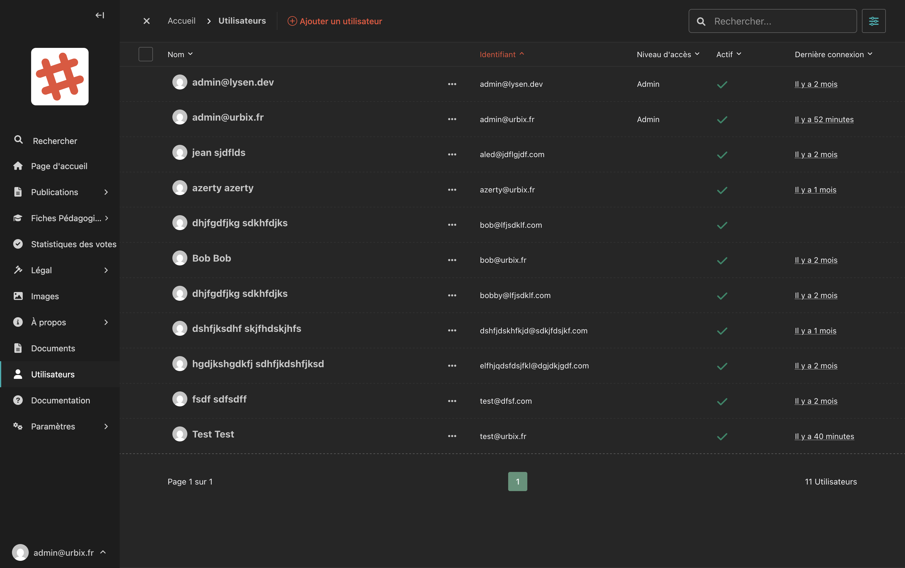

# Gestion des utilisateurs

La gestion des **utilisateurs** permet de gérer les comptes : ceux des habitants comme ceux des membres de l'équipe. Elle est réservée aux **administrateurs**.

## Accéder à la gestion des utilisateurs

Dans la barre latérale, ouvrez **Paramètres** puis cliquez sur **Utilisateurs**.

## La liste des utilisateurs

<!-- Capture d'écran : liste des utilisateurs avec les colonnes Nom, Identifiant, Niveau d'accès, Actif, Dernière connexion -->

La liste affiche pour chaque utilisateur :

| Colonne | Description |
|---|---|
| **Nom** | Le nom complet de l'utilisateur |
| **Identifiant** | L'adresse e-mail utilisée pour se connecter |
| **Niveau d'accès** | **Admin** pour les comptes avec tous les droits techniques |
| **Actif** | ✓ si le compte est actif |
| **Dernière connexion** | La date de la dernière connexion |

## Ajouter un utilisateur

1. Cliquez sur **"Ajouter un utilisateur"** en haut de la page.
2. Remplissez les informations du nouveau compte.
3. Choisissez son **rôle** et, si besoin, ses **groupes**.
4. Cliquez sur **"Enregistrer"**.

## Rôles

Le **rôle** d'un compte détermine ce qu'il peut faire. Chaque rôle a les droits du précédent :

| Rôle | Droits |
|---|---|
| **Citoyen** | Un compte du site : suivre les projets, s'abonner à la newsletter, voter et proposer des idées (voir l'adhésion ci-dessous). Pas d'accès à l'administration |
| **Rédacteur** | Créer et modifier les pages et la médiathèque, puis les **soumettre à la modération**. Ne publie pas |
| **Modérateur** | Publier, dépublier et verrouiller les pages, valider ou refuser les pages soumises, publier les actualités de projet et clore un vote. Modifier l'[annonce](annonce.md), voir les statistiques de participation |
| **Administrateur** | Gérer les comptes et les rôles, les [associations de quartier](associations.md), la [carte](carte.md), les [fonctionnalités](fonctionnalites.md) et les [tâches](taches.md). Seuls les administrateurs modifient les **pages légales** (dont la charte, dont chaque modification demande à tous de l'accepter à nouveau) |

Le menu de chacun ne montre que ce qu'il peut faire. Seuls les administrateurs attribuent les rôles.

**Le dernier administrateur** ne peut être ni rétrogradé, ni désactivé, ni supprimé : nommez-en d'abord un autre.

Chaque changement de rôle ou d'activation, et chaque adhésion enregistrée, modifiée ou supprimée, est inscrit au [journal d'activité](journal.md), avec son auteur.

### Soumettre une page à la modération

Un rédacteur termine sa page puis choisit **Soumettre à la modération** (sous le bouton d'enregistrement). Les **modérateurs et administrateurs actifs** reçoivent un email ; l'un d'eux relit la page, puis la **publie** ou la **refuse** avec un commentaire. Le rédacteur reçoit un email dans les deux cas.

Les groupes Wagtail (*Editors*, *Moderators*) suivent le rôle : ils ne se modifient plus à la main.

### Adhésion

Les habitants **adhèrent en ligne** sur la page **/adhesion/** : ils indiquent leur adresse, choisissent leur [CIQ](associations.md) (le plus proche est proposé), puis paient **10 €** sur **HelloAsso**, au profit de la Fédération. L'adhésion est enregistrée automatiquement dès que HelloAsso confirme le paiement, et un email de confirmation part.

- **Année civile** : une adhésion court jusqu'au **31 décembre**. Payée à partir du **1er décembre**, elle couvre aussi l'année suivante ; un adhérent qui renouvelle en décembre repart au 1er janvier.
- **Mois de grâce** : une adhésion terminée garde ses droits (voter, donner son avis) pendant **un mois**, le temps de la renouveler. Après, l'habitant n'est plus adhérent.
- **Paiements** : **Paramètres › Paiements des adhésions** liste chaque paiement (en attente, payé, abandonné), avec sa commande HelloAsso. La liste est en lecture seule et s'exporte en CSV ou Excel.

Les adhésions se gèrent dans **Paramètres › Adhésions** (administrateurs). Une adhésion a une **date de début**, une **date de fin** facultative, un **CIQ** et une **note** (par exemple le mode de paiement) ; un renouvellement est une nouvelle adhésion. Une personne est **adhérente** tant qu'une de ses adhésions est en cours, ou terminée depuis moins d'un mois. Les adhésions payées par chèque ou en espèces s'enregistrent à la main.

- **Enregistrer une adhésion** : bouton **Ajouter**, puis choisissez la personne (recherche par nom ou email). Depuis la fiche d'un utilisateur, le lien **Enregistrer une adhésion** la présélectionne.
- **Filtrer** les adhésions en cours ou terminées, ou par CIQ, **chercher** par nom, email, CIQ ou note, et **exporter** la liste en CSV ou Excel.
- La fiche de chaque utilisateur indique s'il a une adhésion en cours.

Tant que la participation n'est pas réservée aux adhérents (voir [Fonctionnalités](fonctionnalites.md)), l'adhésion ne change rien : tous les comptes confirmés peuvent voter et proposer des idées. Elle est indépendante du rôle : un membre de l'équipe vote comme habitant, avec la même règle. Quand une personne supprime son compte, ses adhésions en cours se terminent le jour même.

## Modifier un utilisateur

1. Cliquez sur les **"···"** à côté du nom de l'utilisateur.
2. Sélectionnez **"Modifier"**.
3. Effectuez les modifications souhaitées.
4. Cliquez sur **"Enregistrer"**.

## Désactiver un compte

Pour désactiver un compte sans le supprimer, modifiez l'utilisateur et **décochez la case "Actif"**. La personne ne peut plus se connecter, ses contributions sont conservées.

> **Sécurité :** Ne donnez le rôle Administrateur qu'aux personnes qui en ont réellement besoin.

## Ce que les habitants gèrent eux-mêmes

Depuis leur profil sur le site, les habitants peuvent, sans votre intervention :

- **recevoir à nouveau le lien de confirmation** de leur adresse email (nécessaire pour voter ou proposer une idée) ;
- choisir leurs **notifications par email**, toutes désactivées par défaut : *Résultats des votes*, *Actualités des projets*, *Rappels d'événements*. Chaque email contient un lien de désinscription ;
- s'abonner ou se désabonner de la **newsletter** ;
- **Télécharger mes données** : un fichier avec tout ce que le site conserve sur eux (droit d'accès RGPD) ;
- **Supprimer mon compte**.
